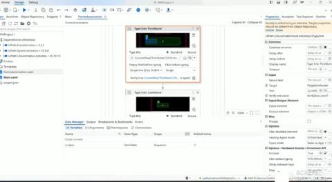
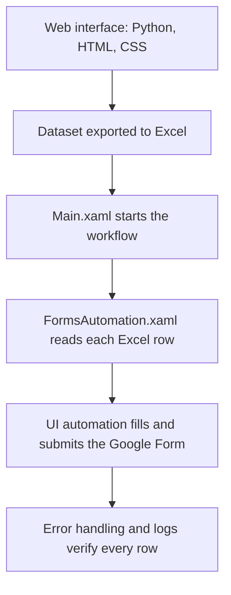

# RPA Automation: Automated Data Entry System

**A Robotic Process Automation (RPA) system that removes repetitive manual data entry.**
A custom web interface, Excel-based data processing and a UiPath workflow work together to populate Google Forms automatically.

> **This is a showcase repository.** The workflow source lives in a private repository. This page documents what the project does, how it is designed, and shows it in action. Happy to walk through the workflow or a live demo on request.

> All data shown is dummy sample data.

[**LinkedIn**](https://linkedin.com/in/ratnesh-pathak-087466279) | [**Email**](mailto:pathakratnesh03@gmail.com)

---

## Preview

*Dashboard of the automation, with the workflow flow.*

---

## Demo Videos

- [Full walkthrough](media/rpa-demonstration.mp4)
- [Short project overview](media/rpa-project-overview.mp4)

Click a link, and GitHub plays the video in the browser.

## The Problem

Filling the same web form row by row from a spreadsheet is slow and error-prone. This project automates that whole loop, from managing the data to submitting the form, so people can spend their time on work that needs judgment.

## What It Does

- End-to-end automation pipeline: data input and management, Excel export, then automated form submission
- Web interface (Python, HTML, CSS) for viewing and managing the data
- UiPath workflows that read Excel rows and dynamically populate web forms
- Error handling so one failed row does not stop the whole batch, with logs to verify results

## How It Works

## Tech Stack

- **Automation:** UiPath Studio (Excel, System and UI Automation activities)
- **Web interface:** Python, HTML5, CSS3
- **Data:** Microsoft Excel
- **Target:** Google Forms
- **Also used:** Java

## Engineering Highlights

- Complete pipeline from data management to form submission, not just a single script
- Resilient runs: failures are handled per row and logged
- Sensitive data kept out of version control, with dummy data only in demos

## Limitations

- Runs locally in UiPath Studio (the Community edition works) and is not a hosted service
- Built for a specific form layout, so a different form needs its selectors updated

## Author

**Ratnesh Pathak** - M.Sc. Information Technology, AI / ML Engineer, Founder of Team Ignites

GitHub: [@RatneshPathak](https://github.com/RatneshPathak) | LinkedIn: [Ratnesh Pathak](https://linkedin.com/in/ratnesh-pathak-087466279) | Email: pathakratnesh03@gmail.com

---

(c) Ratnesh Pathak. All rights reserved. The text, images and videos in this repository may not be reused without permission.
